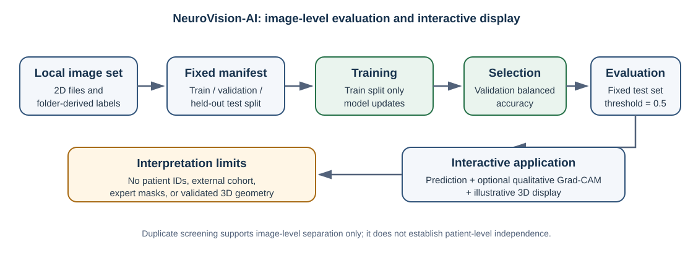
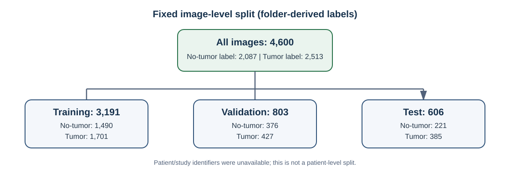
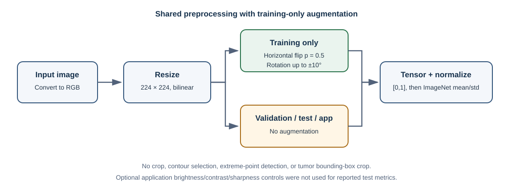
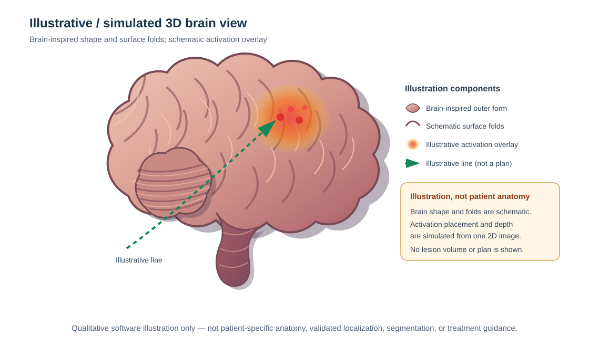
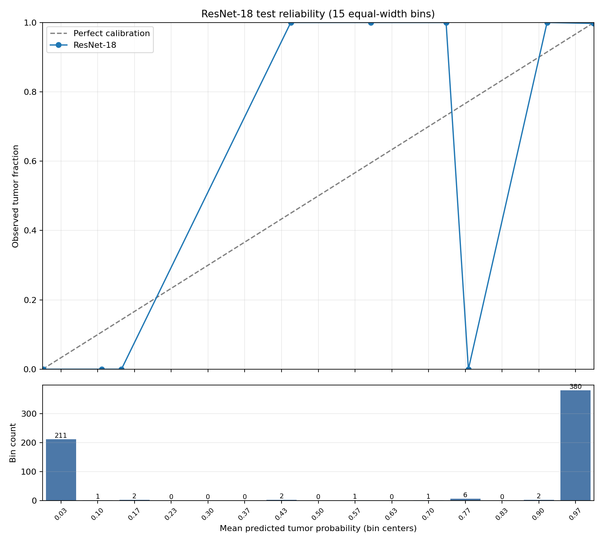
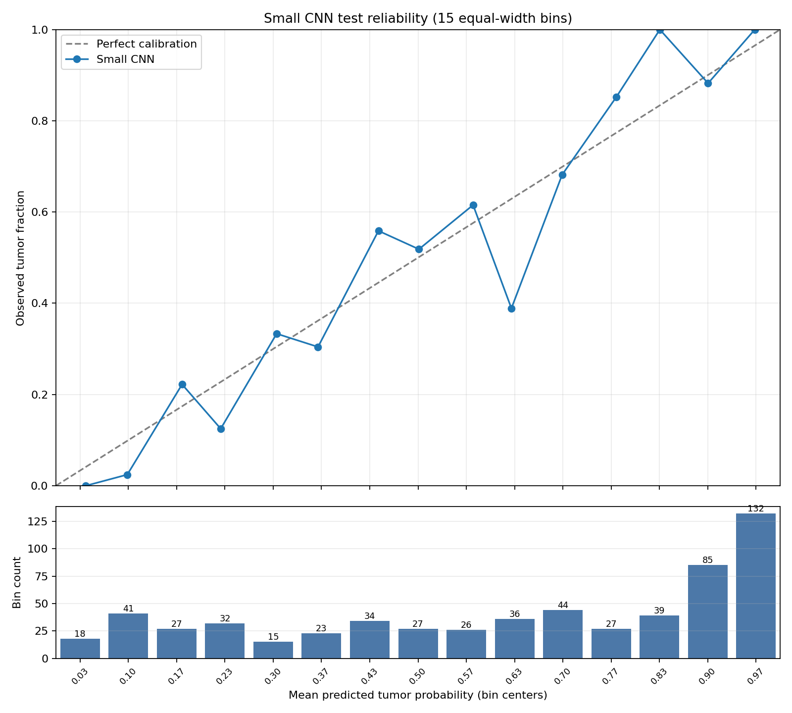
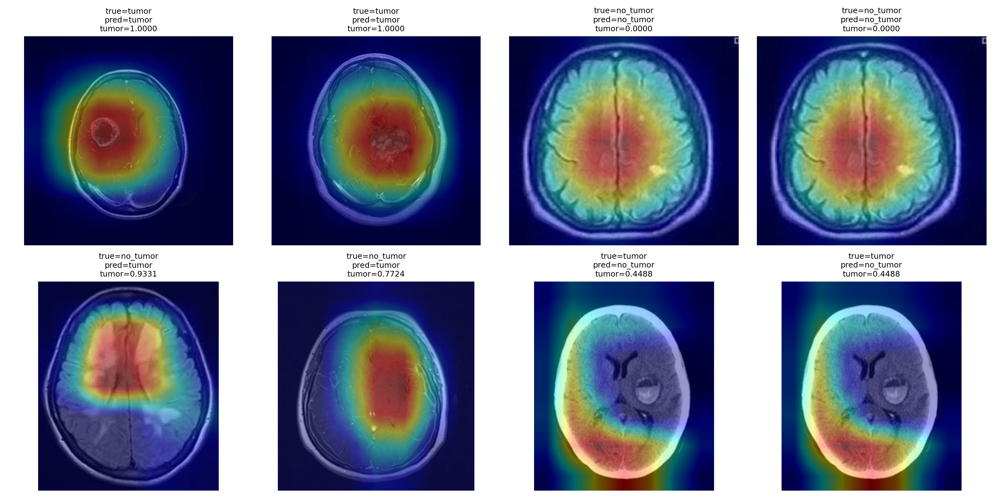
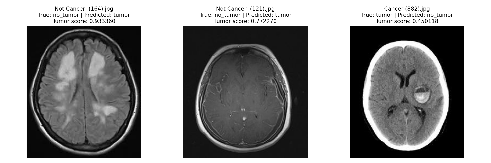

# NeuroVision-AI: An Interactive Brain-Image Classification Prototype and an Audit of Apparent External Performance Loss

## Abstract

### Background
Image classifiers can produce a class score without showing which image regions influenced that score or how a result could be presented in an interactive application. NeuroVision-AI is a research software prototype that combines binary image classification, qualitative Grad-CAM visualization, and an illustrative spatial display. We examined whether high image-level test performance was accompanied by comparable tumor sensitivity on a separately sourced cohort after screening detectable image overlap.

### Methods
We evaluated a locally held collection of 4,600 two-dimensional image files with folder-derived labels: 2,513 tumor-labeled and 2,087 no-tumor-labeled images. A fixed image-level manifest assigned 3,191 images to training, 803 to validation, and 606 to testing. Exact decoded-pixel duplicates were grouped, and near-duplicates were screened using perceptual-hash Hamming distance no greater than 4 together with 64 × 64 grayscale SSIM of at least 0.95. Patient and study identifiers were unavailable, so patient-level separation could not be established. The primary classifier was ImageNet-pretrained ResNet-18; a from-scratch SmallCNN was the primary baseline. Additional multi-seed runs evaluated ResNet-18 and SmallCNN with five seeds each and DenseNet-121 with three seeds. Checkpoints were selected using validation balanced accuracy. We also performed a JPEG-only sensitivity analysis, validation-fitted temperature scaling for SmallCNN, duplicate-group bootstrap analyses, and qualitative Grad-CAM inspection.

### Results
After excluding Cheng patients with an exact or high-similarity image match in any local split, the frozen ResNet-18 achieved 72.41% sensitivity (1,223/1,689; 95% patient-cluster bootstrap interval, 66.90–77.99%) at the fixed 0.5 threshold. This is 27.07 percentage points below the 99.48% sensitivity on the local 606-image test partition, an apparent cross-cohort difference rather than an isolated estimate of domain generalization. The screen removed 1,375 slices from 81 patients, all glioma cases; the remaining cohort contained only 51 glioma slices from 8 patients, alongside 708 meningioma and 930 pituitary slices. Cheng had no no-tumor cases, so specificity and complete binary performance were not estimable. The primary local ResNet-18 also achieved 98.51% accuracy, 98.16% balanced accuracy, 96.83% no-tumor specificity, and ROC-AUC 0.9996. The original SmallCNN checkpoint achieved 81.02% accuracy and ROC-AUC 0.9045. Across repeated runs, mean ROC-AUC was 0.9963 ± 0.0024 for ResNet-18 (five seeds), 0.9087 ± 0.0128 for SmallCNN (five seeds), and 0.9984 ± 0.0007 for DenseNet-121 (three seeds); the runs reused one test partition. SmallCNN temperature scaling reduced test negative log-likelihood from 0.37610 to 0.37069 and 15-bin expected calibration error from 0.06537 to 0.05798, while Brier score increased from 0.24267 to 0.24331. The JPEG-only ResNet-18 accuracy was 98.47%.

### Conclusions
High internal image-level performance did not establish external generalization: the overlap-screened Cheng subset had materially lower tumor sensitivity, although the comparison is confounded by the screen's removal of all matched glioma patients and the absence of a negative class. The study also demonstrates integration of classifier output, qualitative Grad-CAM, and an illustrative spatial display. Image-similarity screening does not prove patient independence, and the results do not establish patient-level diagnosis, validated tumor localization, clinical utility, or local-dataset redistribution rights.

**Keywords:** brain images; image classification; ResNet-18; Grad-CAM; calibration; duplicate screening; research software

## 1. Introduction

Brain tumors are heterogeneous intracranial abnormalities that vary in origin, location, biological behavior, and clinical significance. MRI supports the assessment of brain anatomy and tissue characteristics and is used in image-classification and segmentation research (Bakas et al., 2017; Baid et al., 2021). Public resources such as BraTS support research using volumetric images and annotations, but the local image collection evaluated in this study was not established to be BraTS or any other named public dataset.

Convolutional neural networks can learn image features associated with labeled categories, but a binary classifier does not by itself provide tumor boundaries, size, or anatomical coordinates. Grad-CAM uses gradients with respect to convolutional feature maps to produce class-discriminative heatmaps (Selvaraju et al., 2017). These maps can be inspected as explanations of model responses, but they are not validated tumor masks or definitive localization maps without comparison to appropriate reference annotations (Arun et al., 2021).

This study presents NeuroVision-AI as an interactive software prototype that combines binary image classification, qualitative Grad-CAM display, and a simulated 3D visualization. The contribution is the integration of these interface components, not a new classification architecture or a validated anatomical localization method. The 3D display is illustrative: it uses a 2D heatmap and synthetic spatial assumptions rather than patient-specific volumetric data, image affine transforms, or validated registration. Accordingly, it cannot establish patient-specific tumor location or measured tumor volume.

## 2. Materials and Methods

### 2.1. Study design and software workflow

We evaluated image-level classification using a fixed training, validation, and test manifest. Training data were used for parameter updates, validation data for checkpoint selection, and test data for final evaluation. The test set was not used for checkpoint selection or threshold tuning. The application supports image input, preprocessing, prediction display, and visualization. The image-level evaluation and application workflow are summarized in Figure 1.

**Figure 1.** The fixed manifest drives model training and validation-based checkpoint selection; the held-out test partition is used for evaluation. In the application, an input image is classified, an optional qualitative Grad-CAM is displayed, and an illustrative 3D view is generated. The spatial display is simulated and is not an anatomical reconstruction.

### 2.2. Dataset and partitioning

The audited local collection contained 4,600 readable two-dimensional brain-image files. Labels were derived from the local folder names: 2,513 files were assigned the tumor label and 2,087 the no-tumor label. These are software labels, not independently adjudicated diagnoses. The available repository does not verify the collection's official name, original source, publication, release version, or license, nor does it provide acquisition records establishing the modality and provenance of every file. We therefore refer to it as the **local image collection** rather than asserting a Kaggle dataset identity.

The fixed `split_manifest.csv` was used directly; the training and evaluation code did not randomly create new partitions at runtime. The split was image-level, with detected duplicate and near-duplicate groups kept within a single partition. No patient, study, series, or source-volume identifiers were available, so patient-level separation could not be assessed or guaranteed (Table 1).

The local file audit recorded 4,496 JPEG, 18 PNG, and 86 TIFF images. All 86 TIFF images were assigned the tumor label. The test partition contained 590 JPEG and 16 TIFF images; all 16 test TIFF images were tumor-labeled. Figure 2 summarizes the manifest counts.

**Figure 2.** Counts are based on folder-derived labels in the fixed split manifest. The split is not patient-level.

### 2.3. Duplicate screening and label-conflict audit

An earlier prepared split was found to contain 151 groups of exact duplicate images crossing the training/test boundary. To build the revised manifest, exact duplicates were grouped using decoded-pixel hashes. Candidate near-duplicates were screened using perceptual-hash Hamming distance ≤ 4 and structural similarity (SSIM) ≥ 0.95 on 64 × 64 grayscale images. Detected similarity components were assigned to a single partition. The final manifest audit found no detected exact-duplicate or screened similarity group crossing partitions. This heuristic cannot establish patient identity or rule out all related images.

A separate audit of the full manifest found no label conflicts among 2,773 duplicate-group IDs (0 conflicting groups) and no conflicting labels among 432 decoded-pixel SHA-256 groups shared by two or more images (0 conflicting shared-hash groups). These checks concern label consistency within detected groups; they do not validate the clinical correctness of the folder-derived labels.

### 2.4. Image preprocessing

Images were converted to RGB, directly resized to 224 × 224 pixels using bilinear interpolation, converted to tensors (scaling pixel values to [0, 1]), and normalized channel-wise with mean [0.485, 0.456, 0.406] and standard deviation [0.229, 0.224, 0.225]. The resize did not preserve aspect ratio and did not include a crop.

During training only, random horizontal flip (probability 0.5) and random rotation up to ±10° were applied after resizing and before tensor conversion and normalization. Validation, test, and default application inference used resize, tensor conversion, and normalization without augmentation. The application also offers optional user-controlled brightness, contrast, and sharpness adjustments; these were not applied to the reported test predictions. No contour-based selection, extreme-point detection, bounding-box selection, or tumor-region crop was used.

**Figure 3.** The train branch includes the two augmentations; validation, test, and default inference do not.

### 2.5. Classifiers and training

The primary classifier was `torchvision.models.resnet18` initialized with `ResNet18_Weights.IMAGENET1K_V1` (He et al., 2016). Its final fully connected layer was replaced with a two-output layer for no-tumor and tumor. All model parameters were trainable. The model therefore produced two logits and used softmax-derived tumor scores with a fixed 0.5 classification threshold; this threshold is consistent with the two-class output.

The primary baseline was a SmallCNN trained from scratch. It contained four convolutional blocks with 32, 64, 128, and 256 channels, each using batch normalization and ReLU. Max-pooling followed the first three blocks; the final block fed adaptive average pooling, followed by dropout (0.2) and a two-output linear layer. The SmallCNN had 389,410 parameters, compared with 11,177,538 for ResNet-18.

The additional Phase 1B analysis also evaluated ImageNet-pretrained DenseNet-121 with a replacement two-class head. ResNet-18 and SmallCNN were each run with seeds 42–46; DenseNet-121 was run with seeds 42–44. These runs used the same fixed manifest and matched training configuration but used the separate Phase 1B runner rather than the primary training script. EfficientNet-B0 was not run. A partially completed, interrupted DenseNet-121 run was excluded; only completed runs with summaries are included below.

| Setting | Value |
|---|---|
| Input and labels | 224 × 224 RGB; no-tumor = 0, tumor = 1 |
| Optimizer | Adam |
| Initial learning rate | 1 × 10⁻⁴ |
| Weight decay | 1 × 10⁻⁴ |
| Batch size | 16 |
| Maximum epochs | 12 |
| Learning-rate scheduler | ReduceLROnPlateau; monitor validation balanced accuracy; mode=max, factor=0.5, patience=2 |
| Checkpoint selection | Highest validation balanced accuracy; test metrics not used for selection |
| Early stopping | Patience of 4 epochs without validation improvement |
| Loss / imbalance handling | Unweighted CrossEntropyLoss; no class weights or resampling |
| Random seeds | Primary seed 42; ResNet-18 and SmallCNN multi-seed 42–46; DenseNet-121 42–44 |
| Seed control | Python, NumPy, PyTorch, and CUDA seeds set; cuDNN deterministic enabled and benchmark disabled |
| Device / precision | CUDA when available; recorded primary environment was an NVIDIA GeForce RTX 3050 Laptop GPU; no automatic mixed precision |

The primary ResNet-18 result used the saved seed-42 checkpoint selected at epoch 11 by validation balanced accuracy. The original SmallCNN checkpoint was also selected using validation balanced accuracy. In the multi-seed analysis, the selected epoch varied by run. Checkpoint SHA-256 values and per-run selection metadata are available in the experiment artifacts.

### 2.6. Evaluation metrics and analysis

We report accuracy, balanced accuracy, tumor sensitivity (recall), no-tumor specificity, tumor precision, F1-score, ROC-AUC, and average precision. Confusion matrices use the class order no-tumor then tumor; in `[[TN, FP], [FN, TP]]` form, TN denotes a no-tumor image correctly classified as no-tumor and TP denotes a tumor-labeled image correctly classified as tumor. The primary threshold was fixed at 0.5; no final-test threshold tuning was performed.

The stored primary confidence intervals used duplicate-group-stratified bootstrap resampling, stratified by class. We independently repeated a bootstrap check with 2,000 resamples and seed 0. These intervals are group-based for detected image-similarity groups, not patient-clustered intervals.

### 2.7. Calibration and Grad-CAM

For SmallCNN, temperature scaling was fitted on validation scores only and then applied to test scores. Calibration was summarized using negative log-likelihood (NLL), Brier score, and 15-bin equal-width expected calibration error (ECE). Reliability diagrams show per-bin sample counts.

Grad-CAM was generated for ResNet-18 using the final residual block (`layer4[-1]`) and the predicted class. The heatmap was ReLU-rectified, min-max normalized per image, resized, and overlaid on the input. In the main dashboard, Grad-CAM is shown for tumor-predicted images. No expert tumor masks were available; no IoU, Dice, pointing-game, or other quantitative localization evaluation was performed.

### 2.8. Illustrative 3D visualization

The application's 3D view is an illustrative display derived from a 2D heatmap with synthetic depth/spatial assumptions (Figure 8). It is not built from a patient-specific MRI volume, does not use a validated affine transformation or registration, and does not provide a measured lesion volume. The 3D visualization was not used to train the classifier or calculate classification metrics.

**Figure 8.** Brain-inspired schematic illustrating the concept of the application's simulated 3D display. The brain shape and folds are drawn for illustration; depth and activation placement are synthetic. This is not a patient-specific reconstruction, validated localization, segmentation, or surgical plan.

### 2.9. Software verification

The Streamlit application and focused classifier pipeline were checked with an inference smoke test using a synthetic 224 × 224 RGB input, an application health-endpoint check, and focused tests. The focused test suite passed 19 tests when globally installed pytest plugin auto-loading was disabled. The default pytest invocation failed during external plugin loading, before project tests were collected; this environment issue is not evidence of a project test failure. These checks assess selected software behavior, not diagnostic accuracy or clinical performance.

The current checkpoint loader uses `torch.load(weights_only=True)` with the required `TorchVersion` safe global. Re-inference on all 606 test images using the primary ResNet-18 checkpoint differed from the stored tumor scores by at most 8.6 × 10⁻⁸ and produced the same confusion matrix.

### 2.10. Reproducibility and provenance limitations

The primary ResNet-18 results came from the existing seed-42 checkpoint; it was not replaced by the multi-seed runs. The repository records a code revision and separate local experiment artifacts, but the code and all run artifacts should not be described as fully archived in a single commit. The local collection's source, official name, version, license, and label adjudication are unverified or undocumented. The images are two-dimensional files; no reliable patient/study identifiers, volumetric source data, or expert tumor masks were found. The separate Cheng Figshare v8 cohort was evaluated as described in Section 2.11; BraTS was not evaluated because Synapse authentication was unavailable.

### 2.11. External validation status

The Cheng Figshare v8 cohort was evaluated using the frozen seed-42 ResNet-18 checkpoint at a fixed threshold of 0.5. All four embedded archives passed the Figshare-provided MD5 checks. The official Figshare README specifies the image intensity conversion and label mapping. `cjdata.image` was converted to 8-bit grayscale using per-image min–max scaling, then passed through the shared RGB, resize, and ImageNet-normalization transform. The HDF5/v7.3 decoder transposes the stored matrix axes to restore MATLAB array order; the scipy MAT reader keeps its returned image orientation. No anatomical orientation normalization was applied. Source label codes 1, 2, and 3 map to meningioma, glioma, and pituitary, respectively; all three map to the binary tumor class. The complete archive contained 3,064 tumor-positive slices from 233 patient IDs. A cross-dataset exact-pixel and near-duplicate screen (pHash Hamming distance ≤4 and 64 × 64 grayscale SSIM ≥0.95) found 818 high-similarity slices across 81 Cheng patients with matches in the local train, validation, or test data. All 81 patients (1,375 slices) were excluded from the primary overlap-screened analysis; every excluded slice was glioma. The remaining 1,689 slices from 152 Cheng patients comprised 51 glioma slices from 8 patients, 708 meningioma slices from 82 patients, and 930 pituitary slices from 62 patients. Patient-clustered bootstrap resampling was used for the sensitivity confidence interval. This image-similarity screen does not prove patient independence or rule out undetected overlap. Cheng contains no no-tumor cases, so sensitivity only is estimable. BraTS FLAIR preparation and evaluation code is available, but no BraTS files were evaluated because Synapse authentication was unavailable. BraTS tumor-free slices, when evaluated, must not be interpreted as healthy-participant controls.

## 3. Results

### 3.1. Overlap-screened external tumor sensitivity

On the overlap-screened Cheng subset, the frozen ResNet-18 predicted 1,223 of 1,689 tumor-positive slices as tumor (sensitivity, 72.41%; 95% patient-cluster bootstrap CI, 66.90–77.99%) at the fixed 0.5 threshold. This is 27.07 percentage points below the 99.48% sensitivity on the local 606-image test partition, but the difference is descriptive, not an isolated estimate of domain generalization. The screen excluded 81 matched patients and 1,375 slices; all excluded slices were glioma, leaving only 51 glioma slices from 8 patients in the screened subset. The remaining subset also contained 708 meningioma slices from 82 patients and 930 pituitary slices from 62 patients. Thus, overlap exclusion substantially changed subtype composition. Cheng had no no-tumor cases, so specificity and full binary performance were not estimable. Image-similarity screening does not prove patient independence or rule out residual overlap.

### 3.2. Dataset characteristics and partition integrity

The fixed manifest contained 4,600 image files: 2,087 no-tumor-labeled and 2,513 tumor-labeled. The train, validation, and test partitions contained 3,191, 803, and 606 images, respectively (Table 1). The final partition had no detected duplicate or screened near-duplicate group crossing subsets. This supports image-level split integrity under the implemented similarity screen, but it does not establish patient-level independence or eliminate all possible source-related confounding.

### 3.3. Primary test-set classification results

On the 606-image test partition, the primary ResNet-18 checkpoint achieved 98.51% accuracy and 98.16% balanced accuracy. Its confusion matrix was `[[214, 7], [2, 383]]`, giving 99.48% tumor sensitivity, 96.83% no-tumor specificity, 98.21% tumor precision, and 98.84% F1-score. ROC-AUC was 0.9996 and average precision was 0.9998.

The original primary SmallCNN checkpoint achieved 81.02% accuracy, 78.70% balanced accuracy, 87.27% sensitivity, 70.14% specificity, 83.58% precision, 85.39% F1-score, 0.9045 ROC-AUC, and 0.9462 average precision. Its confusion matrix was `[[155, 66], [49, 336]]` (Table 2). These metrics describe agreement with the dataset's folder-derived labels on this test partition.

For ResNet-18, the stored 95% duplicate-group-stratified bootstrap intervals were 96.28–100.00% for accuracy, 98.40–100.00% for sensitivity, 90.95–100.00% for specificity, and 99.87–100.00% for ROC-AUC. They do not account for patient-level clustering.

### 3.4. JPEG-only sensitivity analysis

The test partition contained 590 JPEG images (221 no-tumor-labeled and 369 tumor-labeled) and 16 TIFF images, all tumor-labeled. Restricting ResNet-18 evaluation to JPEG images yielded 98.47% accuracy, 98.15% balanced accuracy, 99.46% sensitivity, 96.83% specificity, 98.79% F1-score, 0.9996 ROC-AUC, and 0.9998 average precision, with confusion matrix `[[214, 7], [2, 367]]`.

The similar JPEG-only and full-test metrics show that the result was retained in this restricted file-format subset; they do not show that file format or other source/acquisition effects are absent.

### 3.5. Repeated-run results

Across five seeds, ResNet-18 had mean accuracy 98.18 ± 0.31%, balanced accuracy 97.84 ± 0.28%, sensitivity 99.12 ± 0.39%, specificity 96.56 ± 0.25%, precision 98.05 ± 0.14%, F1-score 98.58 ± 0.24%, ROC-AUC 0.9963 ± 0.0024, and average precision 0.9974 ± 0.0017.

Across five seeds, SmallCNN had mean accuracy 82.21 ± 1.10%, balanced accuracy 82.57 ± 2.55%, sensitivity 81.25 ± 4.33%, specificity 83.89 ± 9.02%, precision 90.15 ± 4.48%, F1-score 85.29 ± 0.86%, ROC-AUC 0.9087 ± 0.0128, and average precision 0.9436 ± 0.0087. Across three seeds, DenseNet-121 had mean accuracy 98.51 ± 0.17%, balanced accuracy 98.12 ± 0.14%, sensitivity 99.57 ± 0.30%, specificity 96.68 ± 0.26%, precision 98.12 ± 0.14%, F1-score 98.84 ± 0.13%, ROC-AUC 0.9984 ± 0.0007, and average precision 0.9990 ± 0.0005 (Table 3).

Paired mean differences were calculated over matched seeds: ResNet-18 minus SmallCNN across five seeds, and ResNet-18 minus DenseNet-121 across three seeds. No p-values or significance tests are reported. The sample sizes are small and all runs reused the same fixed test set; these summaries measure run-to-run variability and do not represent independent test populations (Table 4).

The seed-42 ResNet-18 rerun reproduced the primary result. The SmallCNN seed-42 rerun differed from the original saved run on one image, `Cancer (2164).jpg`: the original tumor score was 0.4997877 and the rerun score was 0.5001502, on opposite sides of the 0.5 threshold. This records an observed near-threshold run-to-run change; its cause was not established. The original SmallCNN checkpoint remains the source for the primary single-run result, while the Phase 1B rerun is included in the multi-seed analysis.

### 3.6. Calibration

For SmallCNN, validation-only temperature fitting produced T = 0.7713. On the test set, NLL decreased from 0.37610 to 0.37069 and 15-bin ECE decreased from 0.06537 to 0.05798, while Brier score increased from 0.24267 to 0.24331 (Table 5). This is a mixed, metric-dependent change rather than uniform calibration improvement. The analysis does not establish calibration for ResNet-18.

**Figure 4.** ResNet-18 reliability diagram with 15 equal-width bins and counts beneath the plot. The sparse bin occupancy should be considered when interpreting the curve.

**Figure 5.** SmallCNN reliability diagram with 15 equal-width bins and counts beneath the plot.

### 3.7. Qualitative Grad-CAM and selected error examples

Grad-CAM overlays were produced for selected correct and incorrect predictions from both classes (Figure 6). They are qualitative outputs only. Some examples may belong to the same detected duplicate group; they should not be counted as independent examples. No medical interpretation or quantitative localization conclusion is drawn.

**Figure 6.** Selected test images and predicted-class Grad-CAM overlays. The grid includes correctly and incorrectly classified examples; heatmap intensity is normalized per image and is not a tumor segmentation.

The separate error montage includes two no-tumor-labeled images predicted as tumor and one tumor-labeled image predicted as no-tumor (Figure 7). The displayed values are model scores and labels only; no medical interpretation is intended.

**Figure 7.** The figure reports the dataset label, model prediction, and tumor score for each selected image. It is an error-analysis illustration, not a clinical assessment.

### 3.8. Software verification

The focused classifier pipeline suite passed 19 tests with pytest plugin auto-loading disabled. The application smoke and health checks were successful, and primary-checkpoint re-inference on the 606 test images reproduced the stored predictions to a maximum absolute tumor-score difference of 8.6 × 10⁻⁸ with an unchanged confusion matrix. These software checks do not establish clinical validity.

### 3.9. Summary of findings

The principal finding is an apparent reduction in tumor sensitivity from the local image-level test partition to the overlap-screened Cheng subset, despite high internal metrics. This difference cannot be interpreted as an unbiased estimate of generalization loss: the screen removed every matched glioma case, leaving very few glioma patients and a changed subtype distribution, and independence from the local training data remains unproven. Multi-seed runs showed comparatively low ResNet-18 and DenseNet-121 run-to-run variability and greater SmallCNN variability, particularly in specificity. The Cheng cohort provides no negative-class performance or full external binary evaluation. The calibration, JPEG-only, Grad-CAM, and software checks provide additional descriptive evidence, but do not rule out undetected cohort overlap, resolve the local dataset's missing patient identifiers, or supply expert localization annotations.

## 4. Discussion

The main finding is that the pretrained ResNet-18 achieved high image-level discrimination against the folder-derived labels in this particular held-out partition. The original SmallCNN baseline had lower performance. Multi-seed results add information about variation across training runs, but they do not convert the fixed test set into an independent validation cohort. DenseNet-121's three-seed mean was also high; comparisons between these small, unequal seed sets are descriptive and should not be framed as statistically significant architecture rankings.

The dataset audit improved confidence that detected exact and screened near-duplicate groups did not cross partitions. It does not address patient overlap because the repository contained no reliable patient or study identifiers. Nor does it establish the correctness of the original labels. All TIFF images were tumor-labeled, motivating the JPEG-only sensitivity analysis; similar JPEG-only results reduce concern that TIFF presence alone explains performance but do not rule out other dataset or acquisition shortcuts.

Grad-CAM adds a visual inspection feature, not a localization validation. The collection lacked expert masks, and per-image normalization can make weak activation maps appear visually prominent. The 3D display is similarly a software illustration based on 2D heatmap content and synthetic spatial assumptions; it must not be described as patient-specific reconstruction or tumor-volume measurement.

Finally, the local dataset's official identity, source, version, and license remain unverified in the repository. The Cheng overlap screen found substantial near-duplicate image matches, requiring exclusion of all patients with a detected match. The resulting cohort provides patient-clustered sensitivity only, cannot estimate specificity, and cannot prove independence from every local training source. These gaps limit reproducibility, independent scrutiny, and claims of generalization. Further work needs independently adjudicated positive and negative cohorts, verified training/test provenance and patient separation, volumetric data with expert annotations, quantitative localization evaluation, and calibration assessment on separate cohorts.

## 5. Conclusion

NeuroVision-AI is an interactive research prototype, not a validated diagnostic system. Although the primary ResNet-18 achieved high performance on the fixed local image-level partition, tumor sensitivity was 72.41% on the overlap-screened, tumor-only Cheng subset. The apparent difference is important evidence that the internal score alone is insufficient to support generalization claims, but it is confounded by the exclusion of all matched glioma patients and does not prove patient-independent external performance. Cheng cannot provide specificity or complete binary validation. The findings do not establish clinical reliability or accurate tumor localization; local dataset provenance and licensing must also be resolved before publication or redistribution claims.

## Tables

### Table 1. Dataset class counts, image-level split, and file formats

| Partition / format | No-tumor label | Tumor label | Total |
|---|---:|---:|---:|
| Training | 1,490 | 1,701 | 3,191 |
| Validation | 376 | 427 | 803 |
| Test | 221 | 385 | 606 |
| **All partitions** | **2,087** | **2,513** | **4,600** |
| JPEG files (all splits) | — | — | 4,496 |
| PNG files (all splits) | — | — | 18 |
| TIFF files (all splits) | 0 | 86 | 86 |

Labels are folder-derived and are not independently adjudicated diagnoses.

### Table 2. Primary test-set classification results

| Model / subset | n (no-tumor, tumor) | Confusion matrix `[[TN, FP], [FN, TP]]` | Accuracy | Balanced accuracy | Sensitivity | Specificity | Precision | F1 | ROC-AUC | AP |
|---|---:|---:|---:|---:|---:|---:|---:|---:|---:|---:|
| ResNet-18, full test | 606 (221, 385) | `[[214, 7], [2, 383]]` | 98.51% | 98.16% | 99.48% | 96.83% | 98.21% | 98.84% | 0.9996 | 0.9998 |
| SmallCNN, full test | 606 (221, 385) | `[[155, 66], [49, 336]]` | 81.02% | 78.70% | 87.27% | 70.14% | 83.58% | 85.39% | 0.9045 | 0.9462 |
| ResNet-18, JPEG only | 590 (221, 369) | `[[214, 7], [2, 367]]` | 98.47% | 98.15% | 99.46% | 96.83% | 98.13% | 98.79% | 0.9996 | 0.9998 |

### Table 3. Multi-seed performance (mean ± sample SD)

| Architecture | Seeds (n) | Accuracy | Balanced accuracy | Sensitivity | Specificity | Precision | F1 | ROC-AUC | AP |
|---|---|---:|---:|---:|---:|---:|---:|---:|---:|
| ResNet-18 | 42–46 (5) | 98.18 ± 0.31% | 97.84 ± 0.28% | 99.12 ± 0.39% | 96.56 ± 0.25% | 98.05 ± 0.14% | 98.58 ± 0.24% | 0.9963 ± 0.0024 | 0.9974 ± 0.0017 |
| SmallCNN | 42–46 (5) | 82.21 ± 1.10% | 82.57 ± 2.55% | 81.25 ± 4.33% | 83.89 ± 9.02% | 90.15 ± 4.48% | 85.29 ± 0.86% | 0.9087 ± 0.0128 | 0.9436 ± 0.0087 |
| DenseNet-121 | 42–44 (3) | 98.51 ± 0.17% | 98.12 ± 0.14% | 99.57 ± 0.30% | 96.68 ± 0.26% | 98.12 ± 0.14% | 98.84 ± 0.13% | 0.9984 ± 0.0007 | 0.9990 ± 0.0005 |

### Table 4. Matched-seed differences in performance

| Paired comparison | Seeds (n) | Accuracy difference, percentage points | Balanced accuracy difference, percentage points | ROC-AUC difference |
|---|---:|---:|---:|---:|
| ResNet-18 minus SmallCNN | 42–46 (5) | 15.97 ± 1.15 | 15.27 ± 2.74 | 0.0876 ± 0.0144 |
| ResNet-18 minus DenseNet-121 | 42–44 (3) | −0.33 ± 0.57 | −0.26 ± 0.54 | −0.0015 ± 0.0026 |

Values are paired mean difference ± sample SD across matched seeds. No significance test or p-value was computed; all runs used the same test images.

### Table 5. SmallCNN test calibration before and after validation-fitted temperature scaling

| Test-set measure | Before | After (T = 0.7713) |
|---|---:|---:|
| Negative log-likelihood | 0.37610 | 0.37069 |
| Brier score | 0.24267 | 0.24331 |
| 15-bin equal-width ECE | 0.06537 | 0.05798 |

### Table 6. ResNet-18 duplicate-group bootstrap confidence intervals

| Metric | Stored interval (1,000 resamples, seed 42) | Independent audit interval (2,000 resamples, seed 0) |
|---|---:|---:|
| Accuracy | 96.28–100.00% | 96.01–100.00% |
| Sensitivity | 98.40–100.00% | 98.37–100.00% |
| Specificity | 90.95–100.00% | 90.42–100.00% |
| ROC-AUC | 99.87–100.00% | 99.85–100.00% |

Intervals are percentile intervals from duplicate-group resampling stratified by class. They are not patient-clustered.

## Figure inventory

1. **Figure 1:** [Workflow diagram](experiments_results/manuscript_assets/workflow.svg)
2. **Figure 2:** [Split-count diagram](experiments_results/manuscript_assets/split_flow.svg)
3. **Figure 3:** [Preprocessing diagram](experiments_results/manuscript_assets/preprocessing.svg)
4. **Figure 4:** [ResNet-18 reliability diagram](experiments_results/phase1c/resnet18_reliability_15bin.png)
5. **Figure 5:** [SmallCNN reliability diagram](experiments_results/phase1c/small_cnn_reliability_15bin.png)
6. **Figure 6:** [Selected Grad-CAM examples](experiments_results/phase0/gradcam_examples/gradcam_grid_2x4.png)
7. **Figure 7:** [Selected test-error montage](experiments_results/phase1c/requested_test_image_montage.png)
8. **Figure 8:** [Illustrative simulated 3D display](experiments_results/manuscript_assets/illustrative_3d_view.svg)

## Supporting experiment files

The detailed seed-level metrics and selected epochs are in [phase1b_per_seed_metrics.csv](experiments_results/phase1b/phase1b_per_seed_metrics.csv); architecture-level mean and sample SD are in [phase1b_aggregate_summary.csv](experiments_results/phase1b/phase1b_aggregate_summary.csv); and matched-seed differences are in [paired_seed_comparison_summary.csv](experiments_results/phase1b/paired_seed_comparison_summary.csv). The calibration values are in [small_cnn_calibration.csv](experiments_results/phase1c/small_cnn_calibration.csv), and the independent bootstrap comparison is in [resnet18_group_bootstrap_2000_seed0.json](experiments_results/phase1c/resnet18_group_bootstrap_2000_seed0.json). Review dataset paths and hash-bearing audit files for redistribution/privacy constraints before including them as supplementary material. The current checkpoint hash inventory includes debug and interrupted-run artifacts and should be curated before publication.

## References and author declarations to complete before submission

The supplied draft contained in-text citations but no complete reference list. Verify and append the full bibliographic entries for every cited work (including Baid et al., 2021; Bakas et al., 2017; Arun et al., 2021; Selvaraju et al., 2017; and He et al., 2016) using the target journal's style. Do not use a citation as proof of this local collection's provenance unless it directly identifies the exact source and release used.

The source material did not provide author names/affiliations, funding, conflicts of interest, ethics/consent determinations, or a data/code availability statement. Complete these declarations using the authors' actual information; do not infer them from the repository.
